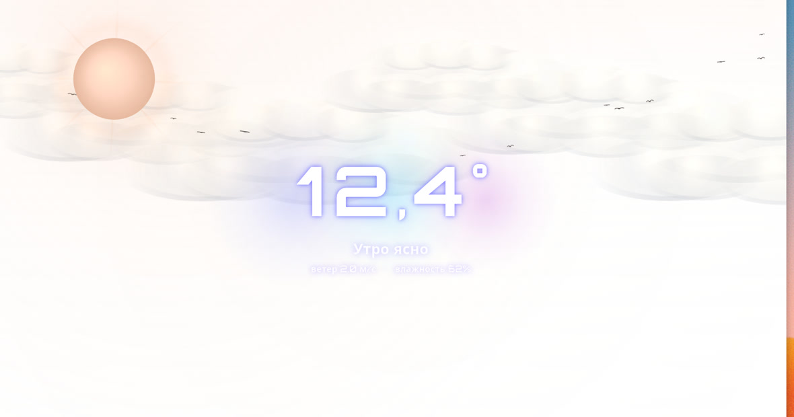
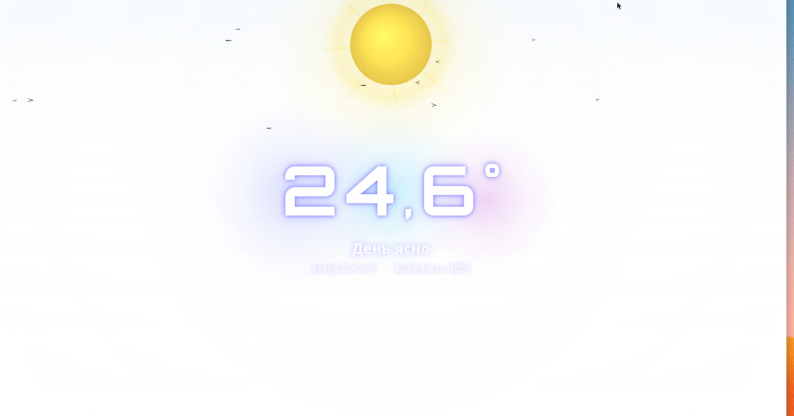
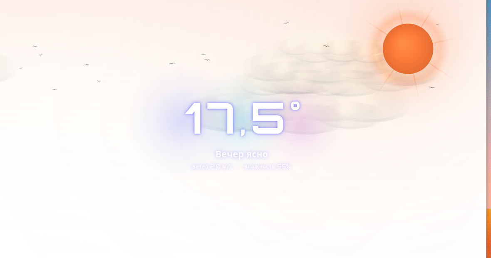
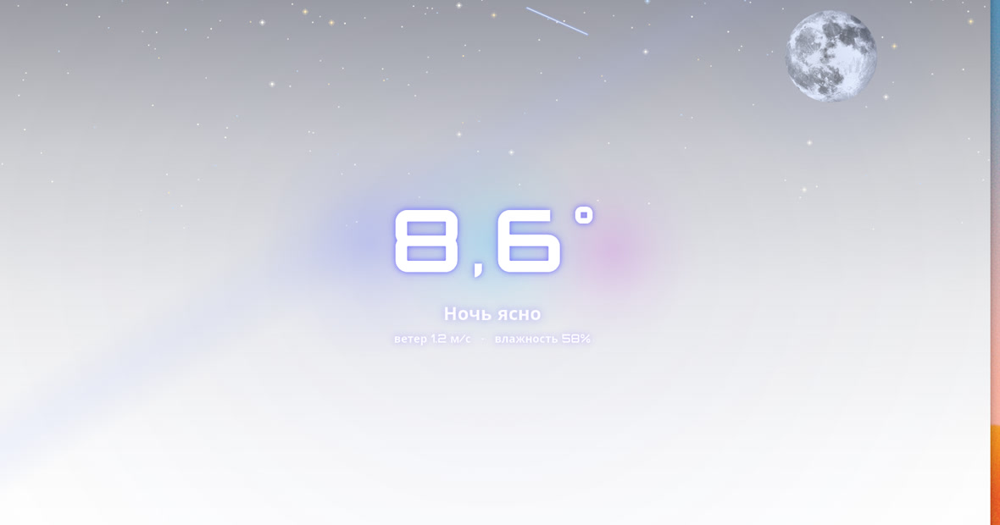
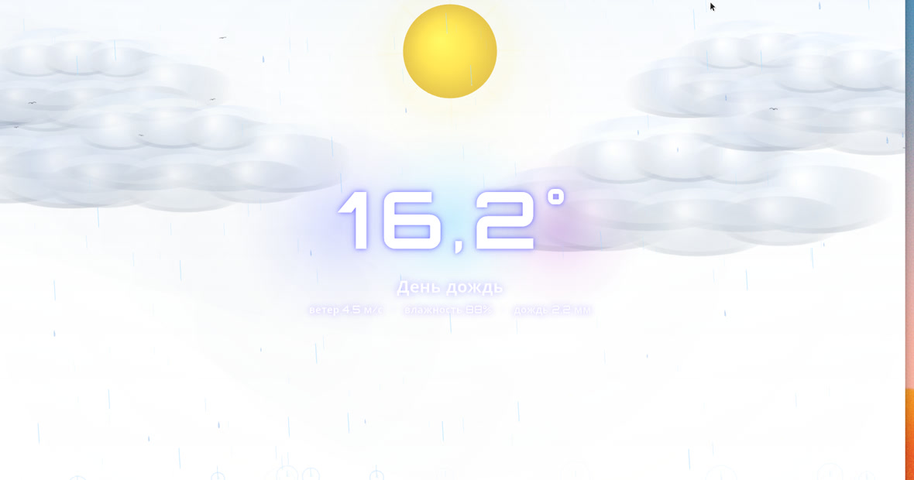
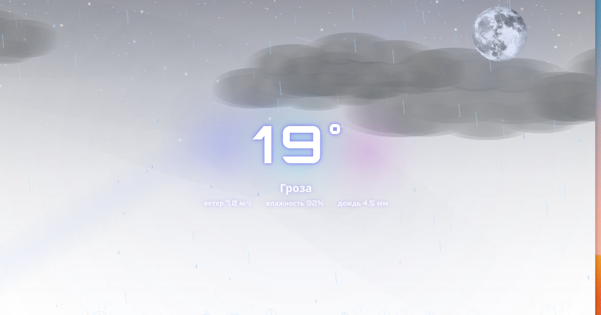
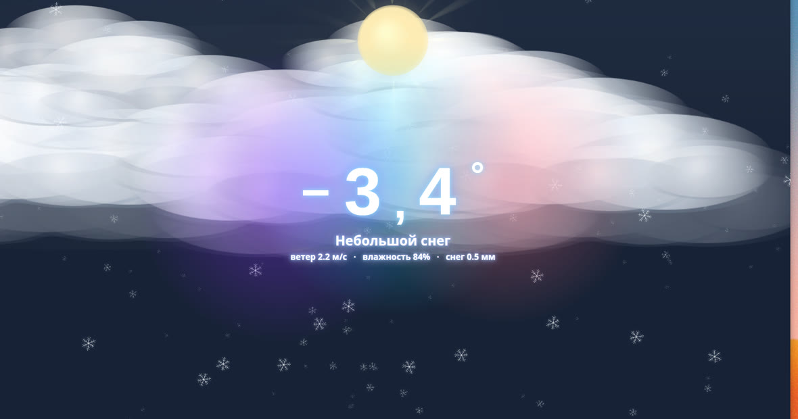
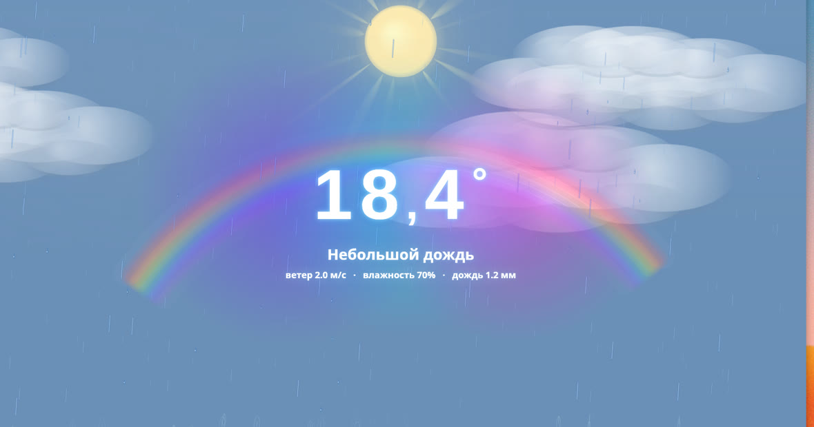

# Стекло

Прозрачный погодный оверлей для Windows: поверх рабочего стола появляется «стеклянная» картина неба с температурой, сама плавно гаснет. Один файл `steklo.py` и рядом `setup.txt`.

<p align="center">
  
</p>

## Что это делает

Программа берёт погоду для выбранного города, смотрит местный рассвет и закат и рисует живую сцену:

- крупная температура и краткое описание;
- голос (по желанию) произносит температуру вместе с появлением цифр;
- солнце, луна, облака, дождь, снег, гроза — по реальной погоде и времени суток;
- через несколько секунд окно само исчезает; щелчок или `Esc` закрывают раньше.

Это не виджет в углу экрана и не сайт в браузере — полноэкранная прозрачная картинка поверх стола.

## Галерея

| Утро | День |
|:---:|:---:|
|  |  |
| Вечер | Ночь |
|  |  |
| Дождь | Гроза |
|  |  |
| Снег | Радуга |
|  |  |

## Функции

### Время суток
По восходу и закату города сцена сама переключается:

| Период | Когда | Что видно |
|--------|--------|-----------|
| **Утро** | от рассвета до 10:30 | тёплое солнце слева, дымка, птицы |
| **День** | с 10:30 до вечера | солнце выше, блики, пылинки в лучах, птицы |
| **Вечер** | последние 2 часа до заката | тёплый закат справа, силуэты птиц |
| **Ночь** | от заката до рассвета | луна, звёзды, Млечный Путь, метеоры |

### Погода на экране
- **Температура** — крупные цифры; при наведении слегка «живые».
- **Ветер, влажность, осадки** — подпись под описанием.
- **Облака** — плотность от облачности; **скорость дрейфа** зависит от силы и направления ветра.
- **Дождь / морось** — капли с наклоном по ветру; у курсора дождь расступается (как под зонтиком).
- **Снег** — крупные хлопья, тоже под ветром.
- **Гроза** — молнии и мягкая вспышка у разряда.
- **Туман / дымка** — приглушённый свет и вуаль.
- **Радуга** — после тёплого дневного дождя при ясном солнце.

### Небо и космос
- **Солнце** — цвет и высота по утру / дню / вечеру; лучи реагируют на курсор.
- **Луна** — реальная **фаза** и положение на небе для координат города; ночью справа, с текстурой диска.
- **Звёзды и метеоры** — ночью; яркость чуть слабее при плотной облачности.

### Живые детали
- Стаи птиц утром и днём (слабее вечером).
- Солнечные пылинки днём.
- Лёгкий параллакс и реакция на движение мыши.
- Плавное появление и исчезновение окна (~60 FPS).

### Голос
При `ГОЛОС = да` температура произносится голосом (edge-tts), строго когда цифры уже на экране.

## Быстрый старт

**Windows 10/11**, Python 3.10+.

```bat
pip install requests pywebview edge-tts
curl -L -o steklo.py https://raw.githubusercontent.com/iona1234/Steklo/main/steklo.py
python steklo.py
```

Или скачайте [`steklo.py`](https://github.com/iona1234/Steklo/blob/main/steklo.py) и запустите двойным щелчком / из терминала. При первом запуске рядом появится `setup.txt`. Зависимости `pywebview` и `edge-tts` при необходимости ставятся сами.

> Пока PR ещё не влит в `main`, берите файл с ветки разработки:  
> https://raw.githubusercontent.com/iona1234/Steklo/cursor/steklo-smooth-launch-3462/steklo.py

## Настройка — `setup.txt`

Файл создаётся сам. Решётка `#` в начале строки выключает её; если две одинаковые — берётся нижняя.

```text
ГОРОД = Barnaul
# ГОРОД = Moscow
# ГОРОД = демо

ДЕМО = нет
# ДЕМО = да

ГОЛОС = да

СКОРОСТЬ = обычно
# СКОРОСТЬ = медленно
# СКОРОСТЬ = быстро

API_КЛЮЧ = …
```

| Параметр | Смысл |
|----------|--------|
| `ГОРОД` | Город для погоды и местного рассвета/заката |
| `ДЕМО` / `ГОРОД = демо` | Без API: по кругу утро → день → вечер → ночь и разная погода (для просмотра эффектов). `Esc` или щелчок — выход |
| `ГОЛОС` | `да` / `нет` — говорить температуру |
| `СКОРОСТЬ` | Как быстро появляется и держится картинка |
| `API_КЛЮЧ` | Ключ OpenWeather; можно оставить как в файле |

## Управление

| Действие | Результат |
|----------|-----------|
| Подождать | Окно само погаснет |
| Щелчок | Закрыть раньше |
| `Esc` | Закрыть |
| Движение мыши | Лучи, параллакс, «зонтик» в дожде |

## Как устроено

1. Читается `setup.txt`, параллельно греются погода и картинка.
2. Считаются время суток, позиция солнца и луны (фаза + высота).
3. Открывается прозрачное окно (pywebview) с canvas-сценой.
4. Голос ждёт сигнала, что цифры уже видны — без рассинхрона.
5. Сцена держится и плавно гаснет.

Весь интерфейс упакован внутри `steklo.py` — отдельная папка `glass/` на диске для запуска не нужна.

## Требования

- Windows 10/11  
- Python 3.10+  
- Сеть для погоды и (опционально) голоса  
- Пакеты: `requests`, `pywebview`, `edge-tts`

## Лицензия и заметки

Репозиторий публичный, код можно смотреть и запускать у себя. Погода — через OpenWeather; голос — Microsoft Edge TTS (Svetlana). Для отладки графики удобен демо-режим в `setup.txt`.
